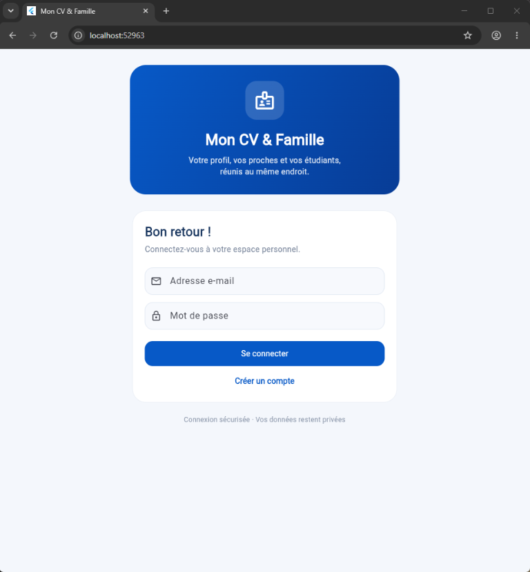
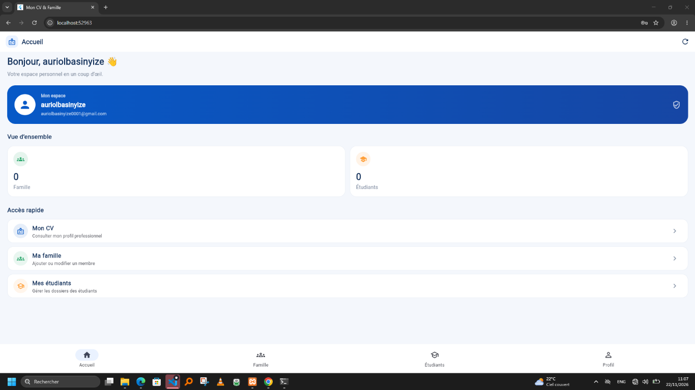
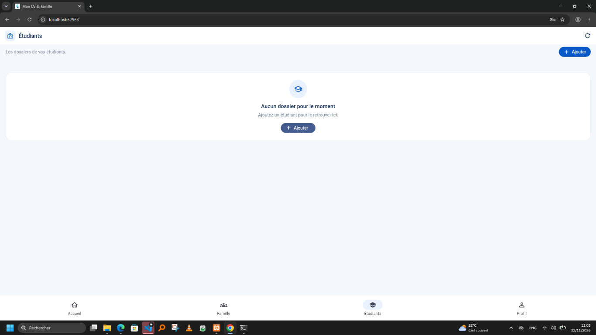
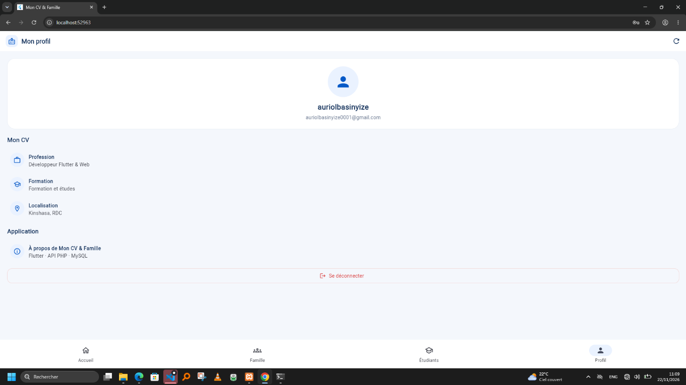

# Mon CV & Famille

Application Flutter de gestion de profil, de famille et d'étudiants.

## Connexion

## Accueil

## Famille

## Étudiants

## Mon profil

## Démonstrations

### Première démonstration

[Ouvrir ou télécharger la première vidéo](https://raw.githubusercontent.com/balamage/cv-flutter-francois-balamage/main/docs/videos/enregistrement-095827.mp4)

### Deuxième démonstration

[Ouvrir ou télécharger la deuxième vidéo](https://raw.githubusercontent.com/balamage/cv-flutter-francois-balamage/main/docs/videos/enregistrement-100315.mp4)
